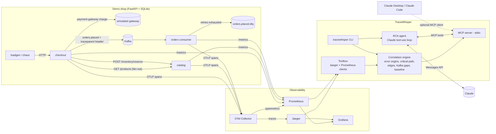

# TraceWhisper

**AI-assisted root-cause analysis for microservices.**

TraceWhisper is a small distributed e-commerce backend (catalog, checkout, orders) instrumented
end-to-end with OpenTelemetry, plus an analysis layer that turns its telemetry into a root-cause
summary. A deterministic correlation engine reduces each trace to the facts that matter (where an
error *originated* versus where it only propagated, which span's own work dominated latency, what
crossed a service or Kafka boundary, and what is slower than a healthy baseline). An MCP server
exposes those tools to Claude, and the agent investigates and returns a structured report.

You don't have to triage logs by hand: run a chaos scenario, ask "why are checkouts failing?", and
get back the failing component, how the failure spread, the evidence and what to do next.

## Architecture



### How a trace crosses the system

1. `POST /checkout` prices the cart with concurrent `GET /products/{sku}` calls to catalog, reserves
   stock, charges the simulated payment gateway, and publishes `orders.placed` to Kafka.
2. The producer injects W3C `traceparent` into the Kafka record headers. The orders consumer
   extracts it, so persisting the order (with its retries and DLQ) belongs to the same trace.
3. Every SQLite statement, HTTP call and Kafka publish/consume is a span. Each one carries
   semantic-convention attributes (`db.statement`, `messaging.destination.name`, `http.route`, ...).
4. The collector sends spans to Jaeger and derives RED metrics (`spanmetrics`) for Prometheus.
   The services also expose their own `/metrics` (HTTP, DB, Kafka, business events).

### What the correlation engine computes (`tracewhisper/tracewhisper/correlate.py`)

| Finding | Meaning |
|---|---|
| Error origins | Failing spans with no failing descendant, plus the chain of ancestors the error propagated through |
| Critical path | A backwards walk from the end of the trace, with each span's self time (time not covered by its children) |
| Hotspots | The spans with the most exclusive time anywhere in the trace |
| Service edges | Every caller->callee hop across a service boundary, labelled http or kafka, with errors and latency |
| Async gaps | How long a message waited in Kafka between publish and consume |
| Baseline deviations | Spans more than N times slower than p95 of the same operation in healthy traces, or failing where they normally don't |
| Suspects | A heuristic ranking of the above, which the LLM uses as a starting point and then verifies |

### MCP tools (`tracewhisper serve-mcp`)

`list_services`, `find_traces`, `analyze_trace`, `span_details`, `service_metrics`, `promql`,
`service_dependencies`. Any MCP client can use them. The bundled agent starts the server over stdio and
gives Claude these tools plus a strict `submit_root_cause` schema (title, root-cause
service/component, category, confidence, propagation chain, evidence, impact, actions, trace ids).

## Repository layout

```
services/            shopcommon (telemetry, metrics, faults, db, kafka) + catalog, checkout, orders
observability/       otel-collector.yaml, prometheus.yml, Grafana provisioning + dashboard
tracewhisper/        analyzer package: models, jaeger, prometheus, correlate, report,
                     toolbox, mcp_server, agent, prompts, cli  (+ tests/)
loadgen/             load.py (Poisson load), chaos.py (fault scenarios with ground truth)
docker-compose.yml   Kafka (KRaft), 3 services, collector, Jaeger, Prometheus, Grafana
```

## How to run

Prerequisites: Docker with Compose v2, Python 3.11+, and an Anthropic API key for the LLM step
(or an `ant auth login` profile). Everything except `investigate` works without a key.

```bash
cp .env.example .env            # set ANTHROPIC_API_KEY (never commit .env)
make up                         # build and start the whole stack
make venv                       # local venv with the analyzer, MCP server and load tools
source .venv/bin/activate && set -a && source .env && set +a
```

| UI / endpoint | URL |
|---|---|
| checkout / catalog / orders APIs | http://localhost:8002 / 8001 / 8003 (`/docs` for Swagger) |
| Jaeger | http://localhost:16686 |
| Prometheus | http://localhost:9090 |
| Grafana (dashboard "TraceWhisper Shop Overview") | http://localhost:3000 |

Generate traffic and break something:

```bash
make baseline                                   # healthy traffic, so a baseline exists
python -m loadgen.chaos list                    # scenarios and their ground truth
python -m loadgen.chaos run slow-catalog-db     # arm the fault, drive load, print trace ids
```

Analyze:

```bash
tracewhisper analyze <trace_id>                       # deterministic findings, no LLM
tracewhisper scan --service checkout --errors-only    # recurring failure origins
tracewhisper investigate "checkouts are failing with 502" --trace-id <trace_id>
make investigate SCENARIO=orders-db-locked            # chaos run followed by an investigation
```

Arm faults by hand through any service's admin API:

```bash
curl -X POST localhost:8001/admin/faults -H 'content-type: application/json' \
  -d '{"point":"catalog.db.query","latency_ms":900,"jitter_ms":300,"duration_s":120}'
curl -X DELETE localhost:8001/admin/faults
```

To use the MCP server from Claude Desktop or Claude Code, register this command:
`/path/to/.venv/bin/tracewhisper serve-mcp`, with `JAEGER_URL` and `PROMETHEUS_URL` in its env.

### Configuration

| Variable | Default | Purpose |
|---|---|---|
| `ANTHROPIC_API_KEY` | - | Claude credentials (the SDK also accepts an `ant auth login` profile) |
| `TRACEWHISPER_MODEL` | `claude-opus-5-5` | Model for the RCA agent |
| `TRACEWHISPER_EFFORT` | `high` | Effort level (`low` to `max`) |
| `TRACEWHISPER_MAX_TURNS` | `12` | Agent turn budget |
| `TRACEWHISPER_SLOW_FACTOR` | `2.0` | A span counts as slow above this multiple of baseline p95 |
| `JAEGER_URL` / `PROMETHEUS_URL` | `http://localhost:16686` / `:9090` | Telemetry backends |

The agent requests use adaptive thinking and opt into server-side refusal fallbacks
(`fallbacks: "default"`). That way an investigation isn't dropped if a safety classifier
false-positives on telemetry content.

## How to test

```bash
make venv
make test        # = cd tracewhisper && pytest -q
```

The unit tests need no Docker, network or API key:

- `test_models.py`: parsing Jaeger JSON, parent/child linking, exception extraction.
- `test_correlate.py`: error origin versus propagation, self time, critical path through the Kafka
  hop, service edges, queue gaps, baseline deviation and suspect ranking. They run against recorded
  fixtures (a payment-gateway failure, an orders DLQ trace, and healthy checkouts).
- `test_report.py`: JSON output for the LLM, the Markdown rendering and the cross-trace summary.
- `test_agent_tools.py`: the tool-use loop with a fake Claude client (parallel tool results, tool
  errors, refusals, report capture) and the toolbox against a Jaeger mocked with `respx`.

For an end-to-end check, run each chaos scenario with `--investigate`. Then compare the report's
`root_cause_component` with the ground truth that `python -m loadgen.chaos list` prints.
